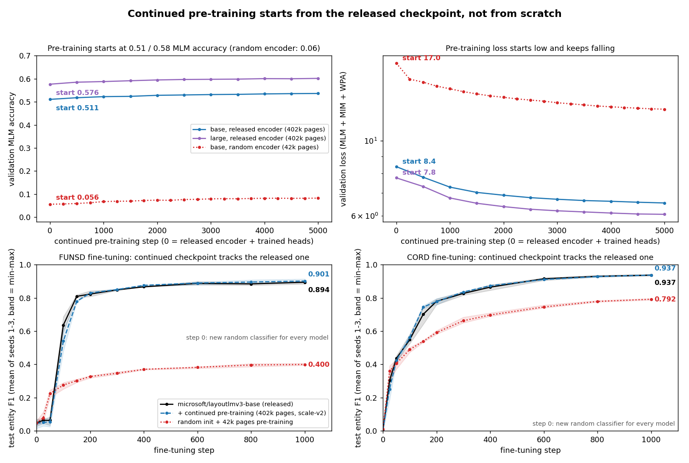

# LayoutLMv3 continued pre-training (MLM, MIM, WPA)

This folder contains an implementation of the three LayoutLMv3 pre-training objectives on top of Hugging Face `transformers`' `LayoutLMv3Model`. Use it to continue pre-training `microsoft/layoutlmv3-base` or `-large` on your own documents:

- masked language modelling (MLM): span masking of 30% of text tokens, span lengths ~ Poisson(3);
- masked image modelling (MIM): blockwise masking of about 40% of the 14×14 image patches;
- word-patch alignment (WPA): a two-layer MLP head.

It was written from the paper. It is not the original training code, and it is maintained as a community contribution. The full experiment history (pre-registered plans, per-seed results and the run registry) is in [14H034160212/layoutlmv3-pretraining](https://github.com/14H034160212/layoutlmv3-pretraining).

## Key check: training starts from the released checkpoint



- **Pre-training (top row):** the released checkpoints contain no pre-training heads. Step 0 is the point after a 1,000-step head-only warm-up: the encoder has not changed, but the new heads have learned to read it. From there, the released encoder starts at **0.511 (base) / 0.576 (large)** masked-token accuracy and loss 8.4 / 7.8. A randomly initialised encoder starts at **0.056** and loss 17.0. Before the warm-up, the random heads make every encoder score about 0, so that point says nothing about the encoder.
- **Fine-tuning (bottom row):** after continued pre-training on about 400k IDL pages, FUNSD and CORD fine-tuning follow the released checkpoint's curves from the first step. Final F1: FUNSD 0.901 vs 0.894, CORD 0.937 vs 0.937. A model pre-trained from scratch on the same data reaches 0.400 and 0.792. At fine-tuning step 0 every model has a new random classifier, so all start near 0 F1; what matters is that the continued and released curves overlap.
- **Downstream effect:** with 10 seeds, continued pre-training on IDL gives a small FUNSD gain of +0.65 F1 (p = 0.047) and no change on CORD.

## Install and test

```bash
cd layoutlmv3/pretraining
pip install -e ".[dev]"
pytest -q
```

## Usage

```bash
# continued pre-training on IDL (pixparse/idl-wds), DALL-E dVAE MIM targets, head warm-up first
python scripts/pretrain.py --model microsoft/layoutlmv3-base --corpus idl --idl_shards 0-259 --idl_val_shards 2999 \
    --pages_per_doc 2 --exclude_funsd_test --image_tokenizer dalle --dalle_encoder /path/to/encoder.pkl \
    --head_warmup_steps 1000 --head_lr 1e-3 --max_steps 25000 --lr 2e-5 --layer_decay 0.9 \
    --batch_size 16 --grad_accum 2 --output_dir runs/base

# downstream check: FUNSD / CORD entity F1 over several seeds
python scripts/finetune_funsd.py --task funsd --model runs/base/backbone --seeds 1 2 3 4 5
```

`python scripts/pretrain.py --help` lists every option. The main ones:
- `--corpus funsd|idl`
- `--image_tokenizer kmeans|dalle`
- `--wpa_head mlp|linear`
- `--head_warmup_steps`
- `--layer_decay`
- `--state_every` / `--resume`
- `--idl_orientation`: IDL frames stored rotated relative to their OCR boxes are fixed by default.

`backbone/` loads directly into `LayoutLMv3ForTokenClassification` and the other LayoutLMv3 task models.

## Differences from the paper

- **MIM targets:** the paper's document dVAE tokenizer is not released. MIM targets come from OpenAI's DALL-E dVAE (as in BEiT v1) or from a k-means codebook.
- **WPA head:** the paper describes a two-layer MLP but gives no further details; this is our reading of it.
- **Scale:** the reported runs use up to about 400k pages, not the paper's 11M.
